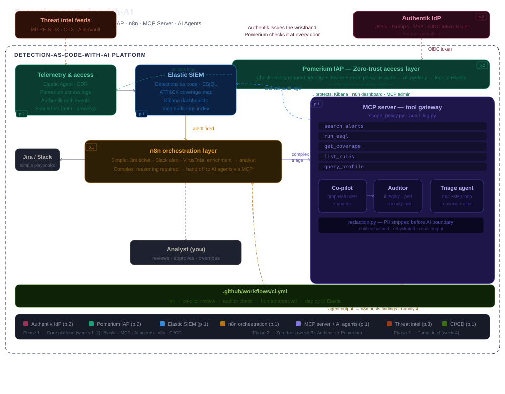

# Detection-as-Code-with-AI

**Building a production-grade, AI-augmented Detection and Response platform using open-source tools.**

Built by Subhadarshi Samal — Senior Detection and Response Engineer.

---

## Current implementation status

The Docker infrastructure foundation is implemented. The closed-loop detection and AI workflows described below remain planned.

Last verified locally: 11 November 2026.

| Component | Current status | Evidence |
|---|---|---|
| Elasticsearch | <br>authenticated health check returned HTTP 200 and green cluster health | `infra/docker-compose.yml`, `infra/elasticsearch/elasticsearch.yml` |
| Kibana | <br>service-account authentication working, container healthy, status API returned HTTP 200 and available | `infra/docker-compose.yml`, `infra/kibana/kibana.yml` |
| n8n | <br>container running; alert routing and enrichment workflows planned | `infra/docker-compose.yml`; `n8n/workflows/` contains only `.gitkeep` |
| Telemetry simulators |  | `telemetry/simulators/` contains only `.gitkeep` |
| Authentik and Pomerium |  | Placeholder directories under `telemetry/beyondcorp/` |
| Detection rules, tests, coverage map, deployment |  | Placeholder directories under `detections/`; no `deploy.py` |
| MCP tools, scope enforcement, audit logging |  | `mcp-server/tools/` contains only `.gitkeep`; no server implementation |
| Co-pilot, auditor, triage, redaction |  | Placeholder directories under `agents/` |
| Threat intelligence pipeline |  | `threat-intel/` contains only `.gitkeep` |
| Detection CI/CD |  | `.github/workflows/` contains only `.gitkeep` |

Kibana logged an Observability AI Assistant error because resolving the ELSER model requires a Platinum, Enterprise, or trial license. Its overall health remained available.

These runtime observations describe the verified local environment; they do not establish production readiness.

## Documentation

The project separates design, build guidance, and implementation evidence:

1. **Design and planning:** [Pre-build document pack](docs/project-documents.md) — technology choices, interfaces, index plans, and dependencies. [Platform design reference](docs/Detection-as-Code-with-AI.md) provides the broader project narrative.
2. **Build guidance:** [Build manual](docs/BUILD-MANUAL.md) — implementation instructions and troubleshooting.
3. **Implementation evidence:** [Implementation logs](docs/implementation-logs/) — session-level work, validation, and outstanding tasks. Start with the [P1-M1 Day 1 log](docs/implementation-logs/P1-M1_Day1_Implementation_Log.md).

Documents record different points in the build. The Day 1 implementation log now includes token generation and validation, configuration hardening, recreation of all three containers, and verified runtime health results, while preserving the earlier chronological history.

---

## What this is

This platform answers a question that comes up in every senior D&R interview: *"How would you build a world-class SOC capability using open-source tooling?"*

The answer is not "install Elastic and write some rules." The answer is a closed-loop system where telemetry feeds detections, detections trigger AI agents, agents produce audited output, and the agents themselves become a detection surface. Every component has a defined role, a defined interface, and a defined feedback path.

This is also a living portfolio — each module maps directly to skills that matter at AI-forward security organizations: detection engineering, zero-trust access, agentic AI, LLM output auditing, REST API integration, and threat intelligence operationalization.

---

## Architecture overview

Target architecture; see the status table for implemented components.




---

## Target Repository Structure (Planned)

Target structure. Many listed scripts and workflow files do not exist yet; current placeholders are listed above.

```
Detection-as-Code-with-AI/
│
├── infra/                        # Elastic stack (Docker)
│   ├── docker-compose.yml
│   ├── .env
│   ├── elasticsearch/
│   │   └── elasticsearch.yml
│   └── kibana/
│       └── kibana.yml
│
├── telemetry/                    # Log sources and simulators
│   ├── simulators/
│   │   ├── auth_events.py (planned)
│   │   └── process_events.py (planned)
│   └── beyondcorp/
│       ├── pomerium.yml (planned)
│       ├── authentik.yml (planned)
│       └── authentik-db.yml (planned)
│
├── detections/                   # Detection-as-code
│   ├── rules/
│   │   └── *.yml (planned)  (ES|QL rules with MITRE mapping)
│   ├── tests/
│   ├── coverage_map/
│   └── deploy.py (planned)
│
├── mcp-server/                   # AI tool gateway
│   ├── server.py (planned)
│   ├── tools/
│   │   └── elastic_tools.py (planned)
│   ├── scope_policy.py (planned)
│   └── audit_log.py (planned)
│
├── agents/                       # AI agent roles
│   ├── copilot/
│   │   └── rule_copilot.py (planned)
│   ├── auditor/
│   │   └── rule_auditor.py (planned)
│   ├── triage_agent/
│   │   └── triage.py (planned)
│   └── shared/
│       └── redaction.py (planned)
│
├── threat-intel/                 # CTI pipeline
│   ├── stix_ingest.py (planned)
│   ├── ttp_mapper.py (planned)
│   ├── gap_finder.py (planned)
│   ├── draft_rule.py (planned)
│   └── otx_feed.py (planned)
│
├── n8n/                          # SOAR-equivalent workflows
│   └── workflows/
│       ├── alert_triage.json (planned)
│       └── alert_enrich.json (planned)
│
└── .github/
    └── workflows/
        └── ci.yml (planned)               # Lint → co-pilot → auditor → deploy
```

---

## Component roles

The following descriptions preserve the target design. Status labels distinguish implemented infrastructure from planned functionality.

### 1. `infra/` — Elastic stack

**Status:** Infrastructure implemented; custom dashboards and ATT&CK heatmap planned.

**What it is:** The data foundation. Elasticsearch stores all security telemetry, detection rule output, and AI agent audit logs. Kibana provides dashboards, the detection rules UI, and the ATT&CK coverage heatmap.

**Why this approach:** The current infrastructure uses `infra/docker-compose.yml` to run Elasticsearch, Kibana, and n8n with named volumes. The Compose stack is intended for local development; licensed Elastic features may require an appropriate license.

**Key interfaces:**
- Elasticsearch REST API (`localhost:9200`) — used by `detections/deploy.py`, `mcp-server/tools/elastic_tools.py`, and `mcp-server/audit_log.py`
- Kibana UI (`localhost:5601`) — dashboards and detection rule management

**Role in the platform:** Everything flows through Elasticsearch. Telemetry is indexed here. Detection rules run against it. AI agent tool calls are logged back into it. It is the source of truth for the entire system.

---

### 2. `telemetry/` — Log sources and synthetic simulators

**Status:** Planned — not implemented.

**What it is:** The raw security signal. Two components: Python simulators that generate realistic synthetic events (auth failures, process executions, lateral movement patterns), and a full zero-trust identity stack: Authentik as the identity provider (IdP) and Pomerium as the Identity-Aware Proxy (IAP). Authentik manages users, groups, MFA, and issues OIDC tokens. Pomerium trusts those tokens and enforces per-route access policy in front of Kibana, n8n, and the MCP server admin interface.

**Why simulators:** A lab without realistic data produces no meaningful detections and no meaningful AI triage output. The simulators generate both benign baseline traffic and injected attack patterns (encoded PowerShell, brute force sequences, suspicious process chains) so every detection rule can be validated against real-looking telemetry.

**Why BeyondCorp/Pomerium:** Every access decision Pomerium makes — device posture, identity, context — becomes a structured log entry indexed into Elasticsearch. This gives the platform a zero-trust log source to write access-anomaly detections against, and it gives you hands-on experience with a Google BeyondCorp-equivalent model on your own infrastructure.

**Key interfaces:**
- Simulators bulk-index events to Elasticsearch via REST API
- Pomerium writes access logs to a dedicated Elasticsearch index

**Role in the platform:** Produces the telemetry that detections run against. The BeyondCorp layer adds a zero-trust access surface that itself becomes a detection source.

---

### 3. `detections/` — Detection-as-code

**Status:** Planned — not implemented.

**What it is:** All detection logic lives as versioned YAML files in this directory. Each rule contains the ES|QL query, MITRE ATT&CK mapping (tactic, technique, subtechnique), severity, response guidance, and test cases. `deploy.py` pushes rules to the Elastic detection engine via REST API.

**Why YAML + CI/CD:** Detection rules are code. They belong in version control with peer review, automated testing, and a deployment pipeline — the same standards applied to application code. This is the core "Detection-as-Code" practice, and it makes every rule change auditable and reversible.

**ATT&CK coverage map:** A `coverage_map/` folder tracks which MITRE techniques have detection coverage and which do not. This feeds directly into the threat intel pipeline (phase 3) and powers a Kibana heatmap dashboard.

**Key interfaces:**
- `deploy.py` will call the Kibana detection rules API
- CI pipeline (`ci.yml`) runs tests, calls the AI co-pilot and auditor, then runs deploy on merge

**Role in the platform:** The detection layer. Every alert that flows into n8n and the AI agents originates from a rule in this directory.

---

### 4. `mcp-server/` — AI tool gateway

**Status:** Planned — not implemented.

**What it is:** A Python MCP (Model Context Protocol) server that exposes a defined set of tools to AI agents. Every interaction an agent has with Elasticsearch, the detection rule library, or query profiling goes through this server — never directly.

**Why MCP:** MCP is the emerging standard for giving AI agents structured, auditable access to external systems. Building your own MCP server rather than using one-off Python functions means tool integrations are written once and any future agent can use them. It also means access can be scoped, logged, and monitored at a single point.

**Tools exposed:**

| Tool | What it does | Who can use it |
|---|---|---|
| `search_alerts` | Query recent alerts by severity, time, entity | Triage agent, co-pilot (read) |
| `run_esql` | Execute an ES|QL query against the SIEM | All agents (read-only) |
| `get_coverage` | Return ATT&CK technique coverage status | Co-pilot, auditor |
| `list_rules` | List deployed detection rules | Co-pilot, auditor |
| `query_profile` | Profile an ES|QL query for performance cost | Auditor only |

**`scope_policy.py`:** Implements least-privilege for AI agents. Each agent role has an allowlist of tools it can call. A triage agent cannot call `query_profile`. An auditor cannot create or modify rules. The same zero-trust principle applied to human users, applied to AI agents.

**`audit_log.py`:** Every tool call an agent makes is written as a structured JSON log entry to a dedicated Elasticsearch index (`mcp-audit-logs`). Fields include: agent role, tool name, arguments, response summary, timestamp, and latency. This is not optional telemetry — it is a first-class security data source.

**Key interfaces:**
- Exposes MCP protocol endpoints consumed by agents in `agents/`
- Writes to Elasticsearch via REST API

**Role in the platform:** The single controlled gateway between AI agents and the rest of the platform. It enforces scope, produces the audit trail, and makes the entire AI layer observable.

---

### 5. `agents/` — AI agent roles

**Status:** Planned — not implemented.

**What it is:** Three distinct AI agents, each with a scoped system prompt, a defined tool allowlist via the MCP server, and a specific job in the D&R workflow.

#### Detection rule co-pilot (`copilot/rule_copilot.py`)

The co-pilot's job is to assist with detection engineering. When a new rule PR is opened, the CI pipeline calls the co-pilot with the rule content. The co-pilot reviews it and returns structured feedback: MITRE ATT&CK mapping completeness, likely false-positive scenarios, missing test cases, suggested query improvements, and whether the rule duplicates existing coverage.

The co-pilot does not approve or deploy anything. It produces a review comment on the PR. The analyst decides what to do with it.

**Tool access:** `run_esql` (to test query logic), `list_rules` (to check for duplicate coverage), `get_coverage` (to verify ATT&CK mapping).

#### Auditor (`auditor/rule_auditor.py`)

The auditor is the two-model critic pattern in action. After the co-pilot produces output — a rule review, a triage assessment, a query suggestion — the auditor independently reviews it before it reaches the analyst or the CI pipeline. The auditor checks three things:

- **Architectural integrity:** Does the proposed rule follow schema conventions? Does it map correctly to the detection rule data model?
- **Performance:** Will this ES|QL query be expensive? The auditor calls `query_profile` to get an actual cost estimate, not a guess.
- **Security risk:** Does the rule create a blind spot? Does it rely on a field an attacker could suppress? Does the co-pilot's output contain anything that looks like a prompt injection artifact?

The auditor's findings are attached to the PR comment alongside the co-pilot's review. The analyst sees both before deciding.

This is the rarest capability in D&R AI tooling — most teams use one model and trust its output. Running an independent critic on every AI output, and logging both sets of findings, is a meaningful security control.

**Tool access:** `run_esql`, `list_rules`, `get_coverage`, `query_profile`.

#### SOC triage agent (`triage_agent/triage.py`)

The triage agent is the most agentic of the three. When n8n routes a complex alert to the AI layer, the triage agent receives the (redacted) alert and runs a multi-step reasoning loop:

1. Calls `search_alerts` to pull related alerts for the same entity over the prior 24 hours
2. Calls `run_esql` to check for additional context (e.g. did this user authenticate from an unusual location in the same window?)
3. Assesses severity, maps to ATT&CK technique, identifies recommended next action
4. Writes structured triage notes citing exactly which tool calls informed each conclusion
5. Returns output to n8n, which posts to the analyst via Slack or updates the Jira ticket

The key difference from a SOAR playbook: the triage agent reasons about what to look for, not just what to execute. The tool-call trace is visible, so the analyst can see the agent's reasoning process, not just its conclusion.

**`shared/redaction.py`:** Before any alert data touches an AI model, this module strips or hashes sensitive fields (usernames, hostnames, IP addresses). The AI works on redacted data. The redaction map is held in memory and used to rehydrate entity names in the final triage output shown to the analyst. This is a data governance control applied at the AI boundary.

**Tool access:** `search_alerts`, `run_esql`.

---

### 6. `n8n/` — Orchestration layer

**Status:** Container implemented; orchestration workflows and integrations planned.

**What it is:** A self-hosted n8n instance running alongside the Elastic stack in Docker. n8n is the first receiver of fired alerts from Elastic and acts as a lightweight SOAR layer.

**Why n8n alongside the MCP server:** These two components serve different purposes and should not be conflated. n8n handles deterministic, repeatable automation — create a Jira ticket, post to Slack, call VirusTotal for IP enrichment. These workflows do not require AI reasoning and should not consume AI API budget. The MCP server and AI agents handle non-deterministic, reasoning-required work — correlating events, assessing intent, writing triage notes.

The routing decision lives in n8n: if the alert severity and type match a simple playbook, n8n handles it entirely. If the alert requires contextual reasoning, n8n calls the MCP server's triage agent endpoint and posts the agent's output back to the analyst.

**Key workflows:**
- `alert_triage.json` — routes alerts, calls triage agent for complex cases, posts findings to Slack
- `alert_enrich.json` — enriches alert entities with VirusTotal, AbuseIPDB, and Shodan before passing to the AI layer

**Role in the platform:** The operational automation layer. Keeps simple things simple and routes complex things to the right place. Prevents the AI layer from becoming a bottleneck for routine work.

---

### 7. `threat-intel/` — CTI pipeline

**Status:** Planned — not implemented.

**What it is:** An automated pipeline that ingests structured threat intelligence, maps it to the platform's current ATT&CK detection coverage, identifies gaps, and uses the AI co-pilot to draft candidate detection rules for uncovered techniques.

**Components:**

- `stix_ingest.py` — Pulls MITRE ATT&CK STIX data from the official TAXII server. Parses techniques, subtechniques, and associated data sources.
- `otx_feed.py` — Pulls recent threat reports from AlienVault OTX. Extracts TTPs mentioned in pulse reports.
- `ttp_mapper.py` — Cross-references ingested TTPs against the ATT&CK coverage map in Elasticsearch. Produces a list of techniques with no detection coverage.
- `gap_finder.py` — Prioritizes coverage gaps by threat actor relevance (are APT groups currently using this technique?), data source availability, and detection difficulty.
- `draft_rule.py` — For the highest-priority gaps, calls the co-pilot agent to draft a candidate ES|QL detection rule. The draft goes through the auditor before being committed to `detections/rules/` as a PR for analyst review.

**Role in the platform:** Closes the loop between external threat intelligence and internal detection coverage. "Staying ahead on adversary TTPs" becomes an automated pipeline that produces actionable detection drafts, not a manual research habit.

---

### 8. `.github/workflows/ci.yml` — CI/CD pipeline

**Status:** Planned — not implemented.

**What it is:** The GitHub Actions pipeline that runs on every PR touching `detections/rules/`.

**Pipeline stages:**

```
PR opened
    │
    ▼
1. Lint          validate YAML schema, required fields, MITRE mapping format
    │
    ▼
2. Co-pilot      AI reviews rule quality, flags issues, suggests improvements
    │
    ▼
3. Auditor       AI independently reviews co-pilot output and rule for risk
    │
    ▼
4. PR comment    both reviews posted as a structured comment for analyst
    │
    ▼
5. Merge (manual approval required)
    │
    ▼
6. Deploy        deploy.py pushes rule to Elastic detection engine
```

**Role in the platform:** Makes detection engineering a disciplined, audited practice. No rule reaches production without schema validation, AI review, independent audit, and human approval.

---

## The two planned signature capabilities

### Two-model critic pattern

Every AI output in this platform is independently reviewed by a second model before it reaches a human or a production system. The co-pilot proposes; the auditor critiques. Neither model knows what the other will say — they run sequentially, not in a shared context window. The auditor's job is adversarial: find what the co-pilot missed.

This pattern addresses the core failure mode of single-model AI in security workflows: an AI that proposes a detection rule with a subtle blind spot has no mechanism to catch it. A second model reviewing specifically for blind spots, query cost, and schema integrity does.

This is also the direct answer to "how do you audit AI-generated output for architectural integrity, performance bottlenecks, and security risks" — it is not a post-hoc code review, it is a built-in automated control in the CI pipeline.

### Agent behavior as a detection source

The MCP server's `audit_log.py` writes every agent tool call to `mcp-audit-logs` in Elasticsearch. Detection rules in `detections/rules/` are written against this index. The platform watches its own AI agents.

Detection examples:
- Triage agent calls `search_alerts` with arguments that look like exfiltration probes (possible prompt injection via a malicious log entry the agent ingested)
- Any agent attempts a tool outside its scoped allowlist (defense in depth — should be blocked at the MCP layer, but this detects if something gets through)
- Auditor pass rate spikes above two standard deviations from baseline (possible system prompt tampering)
- Triage agent produces structured output that diverges significantly from its tool-call trace (agent reasoning and evidence are inconsistent)

This turns the AI layer itself into a monitored, detectable attack surface — which is the correct security posture for any system that processes untrusted data (security logs) and produces privileged output (triage decisions, detection rules).

---

## Implementation roadmap

Original target roadmap, preserved for reference. Week estimates are planning targets, not completion claims. The interview stories below describe the intended outcomes after implementation.

### Phase 1 — Core platform (weeks 1–2)

**Goal:** Working end-to-end demo. Alert fires in Elastic → n8n routes it → triage agent reasons over it → analyst sees structured output.

| Task | Module | Deliverable |
|---|---|---|
| Elastic stack via Docker | `infra/` | `docker-compose.yml`, `.env`, Kibana accessible at `localhost:5601` |
| Synthetic event simulators | `telemetry/simulators/` | `auth_events.py`, `process_events.py` indexing to Elastic |
| 3 starter detection rules | `detections/rules/` | ES|QL YAML rules with MITRE mapping and test cases |
| Rule deploy script | `detections/` | `deploy.py` pushing rules via Elastic REST API |
| MCP server — 2 tools | `mcp-server/` | `search_alerts` and `run_esql` working end-to-end |
| MCP audit logging | `mcp-server/` | `audit_log.py` writing tool calls to `mcp-audit-logs` index |
| Triage agent | `agents/triage_agent/` | Multi-step loop, redaction, structured triage output |
| Co-pilot (CI step) | `agents/copilot/` | Reviews rule PRs, posts structured comment |
| Auditor (CI step) | `agents/auditor/` | Reviews co-pilot output, posts audit findings |
| n8n alert routing | `n8n/` | n8n in Docker, alert webhook → route → triage agent |
| GitHub Actions CI | `.github/workflows/` | Lint → co-pilot → auditor → deploy pipeline |

**Phase 1 interview story:** "I built a detection-as-code pipeline on open-source Elastic where every detection rule goes through an AI co-pilot review and an independent AI auditor before it reaches production. The AI agents themselves are monitored — every tool call they make is indexed back into the SIEM and I've written detections against anomalous agent behavior."

---

### Phase 2 — Zero-trust access layer (week 3)

**Goal:** BeyondCorp-style IAP in front of Kibana. Access decisions become a log source.

| Task | Module | Deliverable |
|---|---|---|
| Pomerium IAP in Docker | `telemetry/beyondcorp/` | `pomerium.yml`, `authentik.yml`, and `authentik-db.yml` (planned); Kibana only accessible via IAP |
| Access log ingestion | `telemetry/` | Pomerium logs indexed to `beyondcorp-access` Elastic index |
| Access anomaly detection rule | `detections/rules/` | ES|QL rule firing on unusual access patterns to security tooling |

**Phase 2 interview story:** "The security tooling itself — Kibana, the n8n dashboard — sits behind a BeyondCorp-style Identity-Aware Proxy. Every access decision is logged and I've written detections that fire if someone accesses the SOC tooling outside normal patterns. Zero-trust applied to the SOC's own infrastructure."

---

### Phase 3 — Threat intelligence pipeline (week 4)

**Goal:** Automated TTP-to-coverage-gap pipeline producing AI-drafted detection rules.

| Task | Module | Deliverable |
|---|---|---|
| MITRE ATT&CK STIX ingest | `threat-intel/` | `stix_ingest.py` pulling from TAXII server |
| OTX feed ingest | `threat-intel/` | `otx_feed.py` parsing pulse reports for TTPs |
| Coverage gap analysis | `threat-intel/` | `gap_finder.py` cross-referencing coverage map |
| AI-drafted rule pipeline | `threat-intel/` | `draft_rule.py` → co-pilot → auditor → PR |
| ATT&CK heatmap dashboard | Kibana | Coverage heatmap showing detected vs undetected techniques |

**Phase 3 interview story:** "The platform ingests MITRE ATT&CK STIX data and threat reports, cross-references them against current detection coverage, prioritizes gaps by active threat actor relevance, and uses AI to draft candidate rules for the top gaps. The analyst sees a PR, not a spreadsheet."

---

## Skills targeted by the completed platform

| Platform capability | Skill demonstrated |
|---|---|
| Elastic SIEM, ES|QL rules, deploy via REST API | SIEM architecture, detection engineering |
| Detection-as-code with GitHub Actions CI | DevSecOps, CI/CD for security content |
| MCP server with scoped tool access | REST API integration, AI tool design |
| Two-model critic pattern (co-pilot + auditor) | LLM output auditing, AI governance |
| Triage agent with multi-step reasoning | Agentic AI, LLM integration in security workflows |
| Agent behavior indexed as detection source | Creative detection engineering, AI security |
| Pomerium IAP in front of Kibana | BeyondCorp / zero-trust access model |
| STIX ingest, TTP-to-coverage gap pipeline | Threat intelligence operationalization |
| n8n orchestration layer | SOAR-equivalent workflow automation |
| Redaction gateway before AI boundary | Data governance, PII handling in AI systems |

---

## Getting started — implemented Docker stack

Prerequisites: Docker Desktop on macOS with at least 8 GB RAM allocated, Docker Compose, and Git. Python 3.11+ and a Claude API key are planned requirements for future modules; the current Docker stack does not require them.

### Local environment

Create `infra/.env` locally if it does not exist. No `.env.example` is currently provided. Configure these variables:

| Variable | Purpose |
|---|---|
| `ES_VERSION` | Shared Elasticsearch and Kibana image version |
| `ELASTIC_PASSWORD` | Initial Elasticsearch administrator password |
| `ES_PORT` | Elasticsearch host port; use `9200` for the examples below |
| `KIBANA_PORT` | Kibana host port; use `5601` |
| `KIBANA_SERVICE_ACCOUNT_TOKEN` | Token for the `elastic/kibana` service account |
| `N8N_PORT` | n8n port; use `5678` to match the current container port mapping |

The n8n image uses `latest`; the inspected runtime version was 2.28.6. n8n uses built-in email-based user management. The last setup-status check indicated owner setup was still required; owner-account creation and interactive login have not been verified.

### Kibana service-account authentication

Kibana reads its token through this path:

`infra/.env` → Compose `environment:` → container environment → `${KIBANA_SERVICE_ACCOUNT_TOKEN}` in `kibana.yml`.

Generate a token for `elastic/kibana` using Elasticsearch's [create service account token API](https://www.elastic.co/docs/api/doc/elasticsearch/operation/operation-security-create-service-token):

`POST /_security/service/elastic/kibana/credential/token/<unique-name>`

Use an authenticated administrator with `manage_service_account`. Capture the returned token securely into `KIBANA_SERVICE_ACCOUNT_TOKEN` in `infra/.env`; do not print it or paste it into tracked files.

`.gitignore` excludes `.env`, `*.env`, and `infra/.env`. Git ignore is not encryption. Do not share the environment file or unredacted Compose configuration output.

Compose rejects a missing or empty token during configuration interpolation. The startup commands below assume Elasticsearch has already been bootstrapped and a valid token saved. A fresh installation needs a separate Elasticsearch-first bootstrap: use a temporary, nonempty interpolation placeholder while starting only Elasticsearch, then generate and save the real token before starting Kibana. The placeholder is not a usable credential.

### Start and verify

From the repository root, after configuring a valid token:

```bash
docker compose --env-file infra/.env -f infra/docker-compose.yml up -d
docker compose --env-file infra/.env -f infra/docker-compose.yml ps
```

For the example ports above, verify Elasticsearch using an interactive password prompt:

```bash
curl --user elastic http://localhost:9200/_cluster/health
curl http://localhost:5601/api/status
```

Use the current Elasticsearch password. Changing `ELASTIC_PASSWORD` in `.env` does not rotate a password already stored in the persistent Elasticsearch data volume.

Kibana is available at `http://localhost:5601`; n8n is available at `http://localhost:5678` when those ports are configured. All three published ports bind only to `127.0.0.1`: Elasticsearch at `127.0.0.1:${ES_PORT}`, Kibana at `127.0.0.1:${KIBANA_PORT}`, and n8n at `127.0.0.1:${N8N_PORT}`. These localhost-only bindings were verified after container recreation; container-to-container communication remains on `detection_network`.

The n8n workflow mount is `../n8n/workflows:/home/node/.n8n/workflows`, resolving relative to `infra/docker-compose.yml` to the repository's `n8n/workflows/` directory. The existing `n8n_data` named volume is preserved. No workflows are implemented or imported yet; mounting the directory does not automatically import workflows.

### Planned setup steps

Telemetry simulators, detection deployment, and the MCP server are not implemented. Commands referencing `auth_events.py`, `process_events.py`, `deploy.py`, or `server.py` are future steps, not runnable setup instructions for the current repository.

---

*This document is the north star for the build. Every code file written, every PR opened, and every demo recorded maps back to a row in the roadmap above.*
