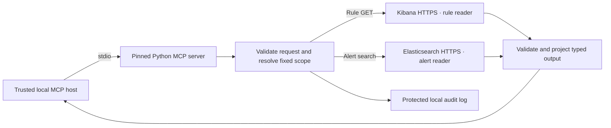

# P1 Day 5 — Secure Elastic Security MCP design

Design reviewed 26 November 2026 against GitHub `main` at
`6b6dd424f9b934e5d31c74018d9e4b4d5ea0a132` (Day 4 PR #4 merge). Its tree
matches the feature-branch closeout. The MCP directory contains only a
placeholder. This proposal covers two read-only tools for the Elastic 8.13
lab. It changes no application code or lab state.

## Architecture

Launch one local stdio process pinned to an absolute interpreter and known
entry point. Keep stdout for protocol frames and send sanitized diagnostics
to stderr. Register only the two tools below. Use one in-flight upstream
operation initially. Avoid HTTP listeners, subprocess tools, client-supplied
configuration, and discovery calls to the lab at startup. Gate stdio input
with a bounded frame check before SDK parsing if the pinned SDK accepts
oversized or duplicate-key frames by default. Test that behavior in the
first smoke test. Local stdio relies
on the host's process isolation. A separate OS user or sandbox would be
required to isolate a hostile same-user process from local credentials.

Reuse the Day 4 HTTPS behavior for loopback IP origins, an explicit CA and
hostname verification, TLS 1.2 minimum, direct connections, strict JSON and
bounded reads. Extract a narrow wire primitive if sharing is useful. Expose
only the fixed rule GET and fixed alert search from the MCP adapter. The Day 2
runtime client includes PATCH, bulk ingestion and an administrator option.
The Day 4 canary transport includes PATCH. Keep both out of the server's
dependency path. The deployment rule projection rejects enabled rules and
nonempty actions. Use a dedicated read projection that validates expected
identity and returned fields without importing deployment eligibility rules.
[Day 4 HTTPS client](../detections/processing/connected_plan.py) ·
[Deployment rule reader](../detections/processing/kibana_rule_reader.py) ·
[Day 2 runtime client](../detections/processing/runtime_client.py)

## Tool contracts

Both inputs are strict JSON objects. In the first release, `space` is
required and must be `default`, and `rule_id` is required and must be
`P1-PS-001`. Reject unknown keys, duplicate keys, type coercion, wildcard or
encoded variants, and caller-supplied routes, aliases, fields, sort keys,
query strings, or DSL. Keep an explicit mapping from the approved space to
the root Kibana route and exact Elasticsearch alias.

| Tool | Input beyond space and rule ID | Output |
|---|---|---|
| `get_detection_rule` | None. | One structured object with space, stable rule ID, rule UUID, rule type, enabled state, revision, interval, severity and risk score. Missing rule has an explicit not-found result. No query, note, action payload, user name or execution-key metadata. |
| `list_detection_alerts` | Required absolute UTC `start` (inclusive), `end` (exclusive), `start < end` and span at most 24 hours. Strict integer `limit` defaults to 20 and allows 1–50. Optional opaque cursor is limited to 1 KiB. | Project only alert ID, timestamp, stable rule ID, severity, risk score and workflow status. Return a page, an optional continuation cursor, and a cap indicator. An evaluated empty page is valid. No raw source, process, host, user, alert reason or free text. |

- **Rules.** Send one `GET /api/detection_engine/rules?rule_id=P1-PS-001`.
  Validate the returned stable ID, canonical UUID, and types of projected
  fields. Confirm the fixed space through the configured route. Treat a
  malformed or unsupported response as an error.
  [Kibana rule read API](https://www.elastic.co/docs/api/doc/kibana/v8/operation/operation-readrule)
- **Alerts.** Send one body-bearing, read-only
  `POST /.alerts-security.alerts-default/_search?allow_partial_search_results=false`
  per page. Generate the DSL from typed values using a fixed term on
  `kibana.alert.rule.rule_id` and a range on `@timestamp`. Use
  `_source: false`, no exact hit total, and only the allowlisted alert
  `fields`. Use `search_after` with a descending timestamp and
  `kibana.alert.uuid` tie-breaker, subject to confirming its installed
  mapping and uniqueness for the approved scope. Reject missing, duplicate
  or malformed sort values. Do not silently fall back to `_id` sorting,
  scroll, or a wider index pattern.
  [Elastic alert aliases and fields](https://www.elastic.co/docs/solutions/security/detect-and-alert/query-alert-indices) ·
  [Elasticsearch 8.13 pagination](https://www.elastic.co/guide/en/elasticsearch/reference/8.13/paginate-search-results.html)
- **Bounds.** Fetch at most one extra hit for lookahead. Cap a traversal at
  200 returned alerts and require a narrower window when capped. Bind the
  cursor to the space, rule, exact time range, page size, sort tuple and
  remaining budget. Sign it with an ephemeral process key, expire it after
  five minutes from the first page, and reject tampered, mismatched or
  restart-stale cursors. Preserve query, sort parameters and original
  expiration across pages. Pagination does not
  create a point-in-time snapshot. Late inserts, deletes or rollover can
  change results during traversal. Cap serialized tool output at 16 KiB and
  upstream JSON at 256 KiB. Propose a five-second upstream search timeout and
  a ten-second client deadline. Test the deadline separately from socket
  inactivity timeouts.

## Identities and failure boundaries

| Principal proposal | Effective grants to verify before live use |
|---|---|
| `p1_mcp_rule_reader` | Kibana feature `siem: ["read"]` in `default` only, with empty base, Elasticsearch cluster, indices and run-as grants. Day 4 exercised this role shape for a single-rule GET. Kibana feature grants remain space-scoped. The application narrows the permitted rule ID. |
| `p1_mcp_alert_reader` | Elasticsearch index `read` on the exact `.alerts-security.alerts-default` alias only. No cluster, run-as or Kibana application grant. Leave restricted-index access disabled. Do not grant metadata access just to inspect mappings. Have an authorized setup identity check mappings separately. Confirm that exact-alias access works on the installed build before enabling this tool. |

The Day 4 reader has no Elasticsearch index grants. The Day 2 operator and
the canary writer have broader capabilities than this server needs. Keep
those roles unchanged. An Elasticsearch alias-level credential can read
other alerts in that space outside the MCP process. The MCP rule filter and
field projection provide application-level narrowing. Field- or
document-level privileges would need a separate license and role review.
If the exact alias grant fails, stop and investigate the concrete permission
instead of adding wildcard, backing index, or write grants.
[8.13 Security feature grants](https://github.com/elastic/kibana/blob/v8.13.0/x-pack/packages/security-solution/features/src/security/kibana_features.ts) ·
[8.13 Elasticsearch privilege definitions](https://www.elastic.co/guide/en/elasticsearch/reference/8.13/security-privileges.html)

Keep separate provisioned credentials in owned mode-`0600` files below an
owned mode-`0700` directory, or inject them through a separately approved
local secret store. Reject symlinks. Resolve credential paths from trusted
launch configuration. Keep credentials out of command arguments, protocol
messages, environment dumps, and audit records. Start the process with an
explicit minimal environment and no credential fallback. Provisioning is
separate from installation and each live read.

Fail closed on invalid input, wrong identity or space, TLS failure, auth
denial, HTTP redirect, timeout, invalid or oversized response, partial shards,
or missing required fields. Separate missing rule, missing alert alias,
denied access, and valid empty results. Suppress upstream exception text and
response bodies. Return only a controlled error code and a request ID. Do
not retry a read automatically in this slice.

Write a bounded local structured audit event before each accepted upstream
operation and another at completion. Record UTC time, generated request ID,
tool, validated scope, outcome code, duration, and result count. Do not
record full arguments, cursors, alert IDs, credentials, raw queries or
responses. Use owner-only storage and a bounded retention policy. Block a
read if the start audit cannot be written and suppress the tool result if
the completion audit fails. Route validation denials to the same sanitized
log where available. This is local operational evidence. No Elasticsearch
audit writes or remote log export are in scope.

## SDK, tests, and first slice

Phase 1 uses the official SDK's low-level `Server` and stdio transport
to control the advertised schemas, frame bounds and error envelopes.
See the [offline setup and tests](../mcp-server/README.md) and the
[implementation log](implementation-logs/P1-M1_Day5_Implementation_Log.md).

Propose the official stable SDK pin `mcp==2.3.0` and its v2 `MCPServer` stdio
API. The upstream minimum is Python 3.10. Target the repository CI interpreter
Python 3.11.14. The workspace's default Python 3.9.6 is too old for the SDK.
Verify an approved local 3.11 interpreter and the specific MCP host's
protocol compatibility via a credential-free stdio smoke test. Resolve and
hash-pin the full dependency set before installation. The SDK requires
packages including `mcp-types`, Pydantic and `httpx2` even with stdio. Keep
the dependency lock isolated from existing detection tools and avoid CLI
extras. Dependency install and any CI workflow changes require approval.
[Official SDK release](https://github.com/modelcontextprotocol/python-sdk/releases/tag/v2.3.0) ·
[Published wheel and provenance](https://pypi.org/project/mcp/2.3.0/) ·
[Tagged Python requirements](https://raw.githubusercontent.com/modelcontextprotocol/python-sdk/v2.3.0/pyproject.toml)

1. **First slice.** On a focused Day 5 branch, implement a stdio shell,
   strict default-space request schemas, sanitized audit stub, and fake
   backend. Prove tool discovery plus successful and denied calls with a
   real local stdio subprocess. Run after approval of the Python environment
   and package lock. Keep the lab disconnected.
2. **Mocked backend slice.** Assert the exact HTTP methods, routes, body,
   credentials and field projections. Cover wrong space/rule, additional
   keys, coercion, missing data, non-JSON, TLS/auth/redirect/timeout failures,
   partial responses, page ordering, cursor expiry/tampering, caps, audit
   failure and absence of secrets on stdout or stderr. Verify both tools
   under the pinned interpreter. Use only synthetic fixtures in CI.
3. **Separate live gates.** Approve each identity and scope independently.
   Validate effective grants without attempting a live write, then approve
   one rule GET with the rule reader. Separately review the alert alias
   mapping and grants, then approve a bounded historical-window search and
   one continuation with the alert reader. Compare to the retained
   synthetic evidence. Record the exact scoped request and sanitized result.
   Stop if the alias, mapping, response, or privileges differ.

**Recording plan:** Record the mocked stdio tool discovery and sanitized input
denial first. At a later approved live milestone, use **RECORD BEFORE** for the
reviewed target and grant summary, then **RECORD AFTER** for the projected
disabled rule, one redacted alert page and audit outcome. Keep terminal
credential setup, raw request/response data and private paths off screen.
Preserve existing footage and avoid repeating a live read for recording.
