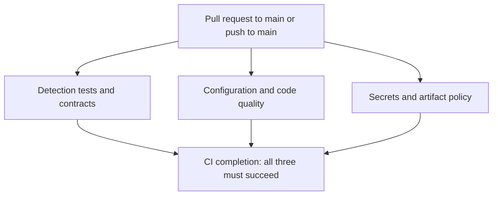

# P1-M1 Day 3 — GitHub Actions CI

**Finalized:** 19 November 2026 (IST). **Outcome:** offline CI implemented, validated and merged through [PR #2](https://github.com/subhsamal/Detection-as-Code-with-AI/pull/2).

## Implementation chronology

1. **18 November — preparation and implementation.** Created `feature/p1-github-actions-ci` from `main`. Added one workflow, offline validators, safety tests, pinned tool installation and documentation. See the [original chronological CI log](P1_GitHub_Actions_CI_Implementation_Log.md) for intermediate findings and decisions.
2. **Placeholder remediation.** Reviewed four Gitleaks `curl-auth-user` findings in the build manual, at original lines 331, 366, 371 and 376. All four contained the literal `YOUR_PASSWORD` placeholder in current content and historical commit `388758e711371bad961799df71eb66d7e3228206`; no actual credential material was present in these findings. Replaced current examples with interactive password prompts and clarified their legacy HTTP context. Exactly four historical commit/file/rule/line fingerprints were documented in `.gitleaksignore`. Current-content scans explicitly use an empty ignore file. No file-wide exception, history rewrite or credential change was made. Canary checks confirmed new occurrences remain detectable.
3. **Local validation.** Unittest discovery passed **91 tests**: the existing 73 tests plus 18 CI regression tests. Gitleaks history/current scans, strict YAML/JSON and Python syntax, detection contracts, Compose config-only validation, Ruff, actionlint, artifact checks and diff formatting passed. Local execution used Python 3.9.6/Ruby 2.6.10; hosted CI below verifies the pinned CI environment.
4. **Publication and hosted validation.** Implementation commit `e1333f203df8e1e25da814432b72f6778f4a66cb` and documentation follow-up `00c3db2fd223e172144feb62b94c45901bba95c5` were pushed normally. Both feature-branch CI runs passed. PR #2 targeted `main`.
5. **19 November — merge verified.** GitHub reports PR #2 merged at **08:50:30 IST** (`03:20:30 UTC`) with merge commit `b598c2ceff16ab87fed9bc94e2a10473360ab93a`. The post-merge push workflow also completed successfully. The documentation-finalization task did not perform this merge.

## Completed architecture

| Parallel job | Implemented validation |
|---|---|
| Detection tests and contracts | All tests via unittest discovery; rule YAML/export/ES\|QL parity, reviewed metadata/source contract, field mappings, schedule and severity/risk types |
| Configuration and code quality | Strict YAML/JSON; Python syntax; configuration security invariants; Compose config only with non-secret placeholders; Ruff; actionlint; diff whitespace |
| Secrets and artifact policy | Gitleaks on history and current publishable files; exact historical exceptions only; reject secrets, recordings and temporary/generated artifacts; verify ignore policies |
| Completion gate | Depends on all three jobs; fails unless each reports success, including failed/cancelled/skipped dependencies. Whole-workflow cancellation cannot establish a successful gate. |

The workflow uses Ubuntu 24.04, Python **3.11.14**, Ruby **3.3.10**, immutable action SHAs and checksum-verified Ruff 0.17.5, actionlint 1.7.12, Gitleaks 8.30.1 and Compose 5.3.0. Validation jobs have ten-minute timeouts; completion has two minutes. Permissions are `contents: read`, with no permissions for completion; checkout does not persist credentials. No repository secrets, live services or deployment resources are needed. [CI reference](../github-actions-ci.md) records exact commands, pins and limitations.

## Hosted evidence

| Run | Revision/event | Tests/contracts | Config/quality | Secrets/artifacts | Completion |
|---|---|---|---|---|---|
| [44337482225](https://github.com/subhsamal/Detection-as-Code-with-AI/actions/runs/44337482225) | `e1333f2`, PR | Passed | Passed | Passed | Passed |
| [44344252288](https://github.com/subhsamal/Detection-as-Code-with-AI/actions/runs/44344252288) | `00c3db2`, PR | Passed | Passed | Passed | Passed |
| [44450751375](https://github.com/subhsamal/Detection-as-Code-with-AI/actions/runs/44450751375) | `b598c2c`, push to main | Passed | Passed | Passed | Passed |

No hosted failures required relaxing checks. No repository settings were changed by this work.

## Validation boundaries and rollback

These results prove offline repository checks and hosted workflow execution. The ES|QL validator is a reviewed contract check, **not an Elasticsearch parser or runtime compatibility test**. Compose validation does not contact Docker Engine or validate live certificates. CI does not establish live Elastic query execution, authentication/authorization, API-key scope, scheduler health, alert generation, severity overrides or deduplication. Day 2 runtime evidence remains separate; no new live Elastic validation was performed on Day 3.

Detection logic, fixtures, infrastructure, credentials and live resources were preserved. Automated deployment/CD remains planned and requires separate approval. If rollback is needed, submit a reviewed revert of the CI change; do not reset history or alter lab data. Future dependency updates must reverify pins/checksums, rerun tests and retain narrow secret exceptions.

Recording plans, footage references and narration remain in the local Git-ignored recording plan, outside the tracked documentation. Active effort was not measured. Next step: review this documentation PR; runtime effectiveness validation remains a separately approved milestone.
